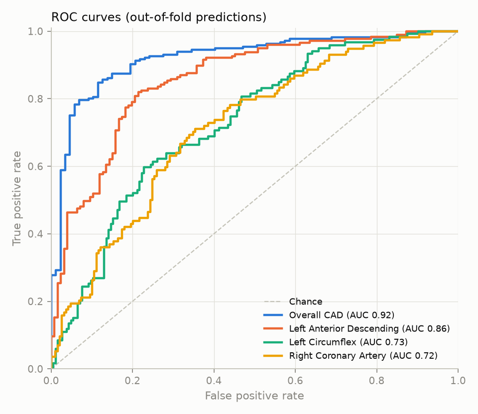
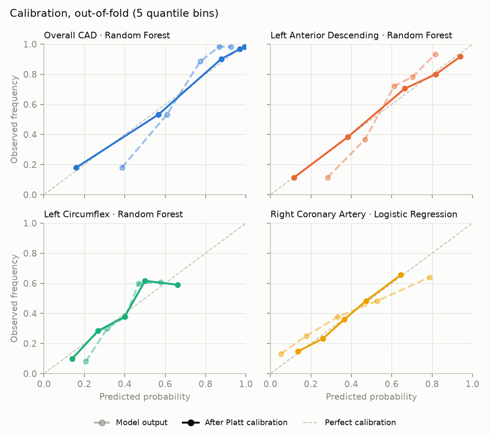
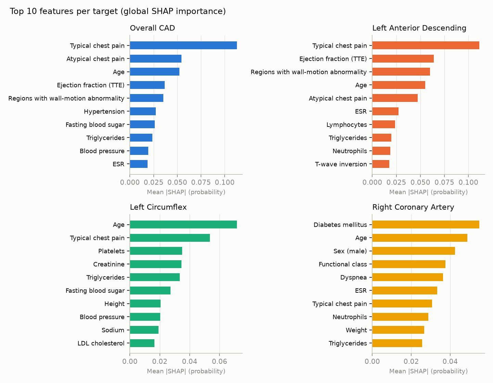

# CardioLens

Interactive 3D cardiovascular risk visualisation and prediction. Multimodal AI Hackathon 2026, Track A.

**Author:** Jayak Chatterjee, solo entry  
**Repository:** https://github.com/jayakchatterjee06-bot/CardioLens  
**Demo video:** [youtube.com/watch?v=gSVCsCLPsU4](https://www.youtube.com/watch?v=gSVCsCLPsU4)  
**PDF version:** [CardioLens_Documentation.pdf](CardioLens_Documentation.pdf)

## 1. Overview

CardioLens predicts a patient's overall coronary artery disease (CAD) status and the stenosis status of the three major coronary vessels, the left anterior descending (LAD), left circumflex (LCX) and right coronary artery (RCA), from routine clinical data, and maps those predictions onto an interactive 3D heart. A clinician enters or loads a patient's 54 clinical measurements; the vessels on the heart recolour by predicted risk, and a dashboard shows the probabilities, the model's decision, and a SHAP breakdown of which measurements drove the estimate.

**Architecture**

- **Frontend (React + React Three Fiber):** patient form generated from the API's feature schema, 3D heart with per-vessel colouring, prediction cards, SHAP chart, model performance panel. Calls `POST /api/predict`, `GET /api/metadata`, `GET /api/samples`.
- **Backend (FastAPI):** validates the 54 inputs against the training schema, runs the four models and their SHAP explainers (loaded once at startup), returns calibrated probabilities with per-feature contributions.
- **ML pipeline (scikit-learn + SHAP):** feature registry, preprocessing, model comparison under repeated cross-validation, calibration, per-target artifacts (`cad`, `lad`, `lcx`, `rca`) plus a manifest and evaluation report.

The three layers share one contract. The feature registry (`ml/features.py`) defines every input once, with its type, clinical group, unit and allowed range; preprocessing, the API request schema and the patient form are all derived from it. The target keys (`cad`, `lad`, `lcx`, `rca`) are the model file names, the API response keys and the names of the vessel meshes in the 3D model, so a prediction for the LAD can only ever colour the LAD. Adding a clinical feature, a prediction target or an anatomical structure means adding one entry to the relevant registry rather than editing the application.

## 2. Dataset and preprocessing

**Source.** UCI Machine Learning Repository dataset 411, "Extension of Z-Alizadeh Sani dataset" (CC BY 4.0): 303 patients, 59 columns, no missing values. Each patient has an angiographic ground truth for overall CAD (`Cath`: CAD / Normal, with CAD defined as at least 50% narrowing) and for each vessel (`LAD`, `LCX`, `RCA`: Stenotic / Normal). The workbook's second sheet is an empty header template and is ignored.

| Target       | Column | Positive label | Positives | Rate  |
|--------------|--------|----------------|-----------|-------|
| Overall CAD  | `Cath` | CAD            | 216 / 303 | 71.3% |
| LAD stenosis | `LAD`  | Stenotic       | 177 / 303 | 58.4% |
| LCX stenosis | `LCX`  | Stenotic       | 119 / 303 | 39.3% |
| RCA stenosis | `RCA`  | Stenotic       | 114 / 303 | 37.6% |

**Leakage control (requirement 1d).** `Cath`, `LAD`, `LCX` and `RCA` are never used as inputs to any model, including the other vessel labels when predicting one vessel. This is enforced in code rather than by convention: the feature registry raises an error if any of these columns reaches a model, saved models are checked for them when loaded, and the API rejects any request containing them (HTTP 422). `Cath` agrees with "any vessel stenotic" on 302 of 303 rows, so the overall label is essentially a summary of the three vessel labels.

**Input features (54).** After dropping the four targets and one constant column (`Exertional CP`, "N" for every patient), 54 features remain across six clinical groups: demographics (age, weight, height, sex, BMI), history and risk factors (diabetes, hypertension, smoking, family history, dyslipidemia and others), symptoms and examination (blood pressure, pulse, chest-pain type, functional class, murmurs, dyspnea), ECG (Q wave, ST elevation and depression, T inversion, LVH, bundle branch block), laboratory (glucose, lipids, renal markers, electrolytes, blood counts) and echocardiography (ejection fraction, regional wall-motion abnormality, valvular disease). One typo in the raw data (`Sex = "Fmale"`) is normalised at load time.

**Encoding.** Each feature's kind is declared in the registry and determines its transform: 21 continuous features are standardised; 29 binary features (Y/N flags, 0/1 flags, sex) map to 0/1; 3 ordered categories (functional class 0–3, regions with wall-motion abnormality 0–4, valvular disease N \< mild \< moderate \< severe) are ordinal-encoded then standardised; the one unordered category (bundle branch block: none / LBBB / RBBB) is one-hot encoded. The result is 56 model columns. The transformer is part of each saved pipeline and is refitted inside every cross-validation fold, so no test fold influences the scaling and inference applies exactly the training-time transform.

## 3. Predictive modelling and evaluation

**Method.** Four independent binary classifiers are trained, one per target, on the same 54 inputs. For each target, three candidate models with fixed, conservative hyperparameters are compared: logistic regression (C = 0.5), random forest (400 trees, minimum leaf size 3) and histogram gradient boosting (depth 3, learning rate 0.05, 200 iterations, L2 = 1). The candidate with the highest cross-validated ROC-AUC is selected, refitted on all 303 patients and saved. Hyperparameters are not tuned per target, which keeps model selection to a single three-way comparison and limits optimistic bias in the reported scores. No class re-weighting is applied: imbalance is mild (38–71% positive) and re-weighting would distort the probabilities that drive the risk colours.

**Validation.** With 303 patients a single hold-out split (about 60 test patients) gives metrics that swing with the draw, so all reported metrics come from repeated stratified 5-fold cross-validation with 5 repeats (25 fits per model, every patient tested five times). Values are mean ± standard deviation across folds. Accuracy, precision, recall, F1 and ROC-AUC are reported as the brief requires; the Brier score is added because the probabilities themselves are displayed.

| Target      | Logistic regression | Random forest     | Gradient boosting | Selected            |
|-------------|---------------------|-------------------|-------------------|---------------------|
| Overall CAD | 0.923 ± 0.032       | **0.923 ± 0.037** | 0.900 ± 0.045     | Random forest       |
| LAD         | 0.830 ± 0.051       | **0.852 ± 0.047** | 0.812 ± 0.045     | Random forest       |
| LCX         | 0.692 ± 0.076       | **0.729 ± 0.065** | 0.722 ± 0.066     | Random forest       |
| RCA         | **0.728 ± 0.055**   | 0.716 ± 0.055     | 0.693 ± 0.066     | Logistic regression |

Table 1. Cross-validated ROC-AUC of the three candidates per target. For CAD, logistic regression tied the random forest on AUC with a slightly better raw Brier score; the random forest was kept under the selection rule fixed before the run.

| Target      | Model               | ROC-AUC       | Accuracy      | Precision     | Recall        | F1            | Brier         |
|-------------|---------------------|---------------|---------------|---------------|---------------|---------------|---------------|
| Overall CAD | Random forest       | 0.923 ± 0.037 | 0.857 ± 0.043 | 0.864 ± 0.033 | 0.950 ± 0.036 | 0.904 ± 0.029 | 0.115 ± 0.014 |
| LAD         | Random forest       | 0.852 ± 0.047 | 0.786 ± 0.048 | 0.777 ± 0.047 | 0.893 ± 0.059 | 0.829 ± 0.039 | 0.166 ± 0.014 |
| LCX         | Random forest       | 0.729 ± 0.065 | 0.676 ± 0.056 | 0.657 ± 0.137 | 0.361 ± 0.102 | 0.462 ± 0.113 | 0.207 ± 0.014 |
| RCA         | Logistic regression | 0.728 ± 0.055 | 0.669 ± 0.048 | 0.572 ± 0.074 | 0.481 ± 0.108 | 0.518 ± 0.088 | 0.209 ± 0.025 |

Table 2. Full cross-validated metrics of the selected model per target (decision threshold 0.5).

**Calibration.** The 3D viewer colours each vessel by its predicted probability (green below 33%, amber 33–66%, red above 66%), so the probabilities must match observed frequencies. Random forests compress probabilities towards 0.5: out of fold, CAD patients scored around 0.39 by the raw model had CAD only 18% of the time, which would have shown healthy patients as amber. Each selected model is therefore wrapped with a Platt calibrator (a two-parameter logistic map on the model's logit) fitted on its out-of-fold predictions. The map is monotone, so ranking and ROC-AUC are unchanged. Calibration is evaluated cross-fitted, so each patient's calibrator never saw that patient. Table 3 reports the deployed models on this basis; Figure 2 shows the effect.

| Target      | ROC-AUC | Accuracy | Precision | Recall | F1    | Brier raw → calibrated |
|-------------|---------|----------|-----------|--------|-------|------------------------|
| Overall CAD | 0.915   | 0.871    | 0.893     | 0.931  | 0.912 | 0.116 → 0.100          |
| LAD         | 0.851   | 0.789    | 0.796     | 0.859  | 0.826 | 0.164 → 0.152          |
| LCX         | 0.723   | 0.696    | 0.652     | 0.487  | 0.558 | 0.207 → 0.206          |
| RCA         | 0.712   | 0.657    | 0.566     | 0.377  | 0.453 | 0.214 → 0.205          |

Table 3. Deployed models (selected model + calibration), out-of-fold predictions, threshold 0.5.

*Figure 1. ROC curves from out-of-fold predictions. Overall CAD and LAD are predicted well from clinical data; LCX and RCA are harder.*

*Figure 2. Reliability curves before (faded) and after Platt calibration (solid). Five quantile bins; the dashed diagonal is perfect calibration.*

**Reading the results.** Overall CAD (AUC 0.92) and LAD stenosis (0.85) are predicted well from non-invasive data. LCX and RCA stenosis are harder (0.73 each): at the 0.5 threshold their recall is 0.49 and 0.38, so roughly half of stenosed LCX/RCA patients are called negative. This is an honest limit of predicting individual vessels from clinical features alone, and the interface relies on the probability bands rather than the binary call, so a 45% RCA risk is shown as moderate rather than hidden behind "negative".

## 4. Explainability

Every prediction comes with a SHAP breakdown. Tree models use exact TreeSHAP with interventional feature perturbation; logistic regression uses permutation SHAP on the model's probability output. All explanations are expressed in the same unit, probability of the positive class, so a contribution of +0.12 always means "this measurement raised the estimated risk by 12 percentage points" regardless of which model won for that target. SHAP values of one-hot columns are folded back into their clinical feature, contributions are rescaled onto the calibrated probability scale, and the raw patient value with its unit is attached to each one, so the dashboard shows "Ejection fraction (TTE) 35%, +6.8 points" rather than a scaled coefficient. A test asserts that, for every model type and calibrator, the base value plus the 54 contributions equals the displayed probability. A reference set of 100 patients saved with the models is the SHAP background; global importance (mean \|SHAP\| over all patients, Figure 3) is computed at training time and served with the model metadata.

*Figure 3. Top ten features per target by mean absolute SHAP value. Typical chest pain, age, ejection fraction and regional wall-motion abnormality dominate CAD and LAD; diabetes, age, sex and functional class dominate RCA.*

## 5. 3D pipeline

**Anatomy source.** The heart is built from BodyParts3D (Database Center for Life Science, CC BY 4.0), the resource suggested in the brief. A build script (`tools/build_heart_model.py`) downloads the part-of mesh archive, selects meshes by FMA concept and merges them into one glTF binary (`frontend/public/heart_model.glb`) with one named node per structure:

| glTF node                                                               | BodyParts3D concept                                                                      | Role                      |
|-------------------------------------------------------------------------|------------------------------------------------------------------------------------------|---------------------------|
| `lad`                                                                   | FMA3862 anterior interventricular branch of left coronary artery                         | coloured by the LAD model |
| `lcx`                                                                   | FMA3895 circumflex branch of left coronary artery                                        | coloured by the LCX model |
| `rca`                                                                   | FMA50039 right coronary artery                                                           | coloured by the RCA model |
| `left_main`, `myocardium`, `aorta`, `pulmonary_trunk`, `coronary_veins` | FMA3855, FMA7088 (less the coronary vessels), FMA3736 + FMA3768, FMA8612, coronary veins | anatomical context        |

The script re-orients the meshes from BodyParts3D's coordinate system (Z up, anterior −Y) to the renderer's (Y up, anterior towards the camera), centres the heart and scales it to a fixed height, and decimates the myocardium and veins so the whole model is about 66,000 triangles and 1.2 MB. The vessel nodes keep full resolution. Because the node names are the ML target keys, the correspondence between model outputs and displayed structures (technical consideration 3) is a naming invariant rather than a lookup table.

**Rendering and interaction.** The frontend uses React Three Fiber with drei. Each vessel is a separate mesh whose material colour is set from its calibrated probability through a single risk-band function shared with the dashboard. Vessels respond to hover and click; clicking selects the vessel, highlights it, and switches the SHAP chart to that vessel's model. Labels are HTML elements projected from a stable anchor point on each vessel's surface each frame, dimmed when the anchor faces away from the camera. Orbit controls give rotation and zoom, and a toggle makes the myocardium translucent to reveal vessels behind it. On an integrated-GPU laptop the scene renders at full frame rate; the model loads in two to three seconds on first visit.

## 6. Clinical dashboard and API

*Figure 4. The application with a single-vessel (LAD) patient loaded: patient form (left), 3D heart with LAD at 99% (red), LCX 8% (green) and RCA 35% (amber), and the prediction panel with the SHAP breakdown (right). The safety disclaimer is fixed across the top of every view.*

The right-hand panel shows the overall CAD probability with its risk band and whether it is above or below the 50% decision threshold, the three vessel probabilities (clickable, kept in sync with the heart), the SHAP chart for the selected vessel (overall CAD when none is selected) with each measurement's value, unit and contribution in percentage points, and a table of each model's cross-validated performance. The left-hand form offers four real patients from the dataset (normal angiogram, borderline, LAD-only, three-vessel disease) and the 54 inputs in six collapsible clinical groups. Any edit re-predicts after a short pause, so the heart recolours as values change; invalid values are flagged on the field with the server's message and the last valid prediction stays visible. A note states that sample patients were part of the training data, so their predictions are more confident than for new patients.

**API.** The FastAPI backend exposes `GET /api/metadata` (the 54 features with labels, units, allowed values and ranges, plus each target's model and metrics), `GET /api/samples`, `GET /api/health` and `POST /api/predict`, which returns, for each target, the calibrated probability, the threshold decision, the base value and all 54 contributions. The request schema is generated from the feature registry: unknown categories, out-of-range values, missing fields and any extra field (including the four target columns) are rejected with HTTP 422. Models and explainers load once at startup with a warm-up prediction, after which a request takes about 0.45 s on a laptop. Interactive documentation is served at `/docs`.

## 7. Usage

Requirements: Python 3.11, Node 18 or newer, and a modern browser. On macOS the setup script installs Python and Node through Homebrew if they are missing; on Linux install them first; on Windows use WSL or run the manual commands below.

    git clone https://github.com/jayakchatterjee06-bot/CardioLens
    cd CardioLens
    ./setup.sh        # creates .venv, installs Python and npm packages (once)
    ./start.sh        # starts the API (:8000) and the UI (:5173), opens http://localhost:5173

Manual alternative: `source .venv/bin/activate && uvicorn backend.main:app --port 8000` in one terminal and `cd frontend && npm run dev` in another. Other commands, run from the project root with the virtual environment active: `python -m ml.train` retrains all four models and regenerates `ml/reports/` (about two minutes); `pytest -q tests` runs the 54 tests, which cover the leakage guard, preprocessing, calibration, SHAP additivity, the saved artifacts and the API end to end; `python -m tools.build_heart_model` rebuilds the heart mesh. Exact package versions are frozen in `requirements.lock.txt` and `frontend/package-lock.json`; the trained model files and the dataset are included in the repository so a clone runs without downloading anything.

## 8. Limitations and clinical safety

**Decision support and educational use only.** CardioLens is a prototype trained on 303 patients from a single centre. Its outputs are not a diagnosis and are not a substitute for formal diagnostic imaging such as coronary angiography or for professional medical judgement. This disclaimer is displayed permanently in the interface and returned with every API response.

- **Small, single-source dataset.** 303 patients from one hospital in Iran; performance on other populations is unknown and the ± intervals are wide. No external validation was possible within the hackathon.
- **Vessel-level prediction is hard.** LCX and RCA reach AUC 0.73 with low recall at the 0.5 threshold. The interface therefore foregrounds probabilities and risk bands rather than binary calls.
- **Sample patients are in-sample.** The four demo patients were used for training, so their predictions are more confident than those for a new patient; the interface says so whenever one is loaded.
- **Anatomy is generic.** The 3D heart is a reference model, not the patient's own anatomy; vessel colours represent predicted risk per vessel, not lesion location along the vessel.
- **Not a medical device.** No regulatory validation, audit logging or access control has been implemented.

## 9. Development process and acknowledgements

CardioLens was built by Jayak Chatterjee as a solo entry using Claude Code (Anthropic) as an agentic coding assistant. Claude Code subagents scaffolded the repository, downloaded and inspected the dataset, wrote and ran the training and evaluation code, built the BodyParts3D mesh pipeline, implemented the API and the React application, and verified the running application in the browser against the live backend. The author set the plan and phase order, reviewed each phase's output and results, made the design decisions recorded in this document (model selection rule, calibration, the shared feature registry and the vessel naming invariant), and tested the application independently before each commit. Dataset: Alizadehsani et al., "Extension of Z-Alizadeh Sani dataset", UCI Machine Learning Repository (CC BY 4.0). Anatomy: BodyParts3D, © The Database Center for Life Science, licensed under CC Attribution 4.0 International. Libraries: scikit-learn, SHAP, FastAPI, pandas, trimesh, React, three.js, React Three Fiber and drei.
